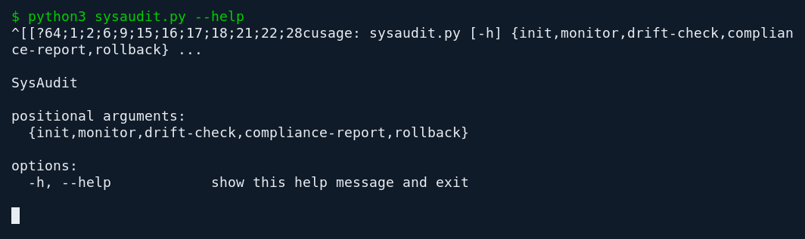
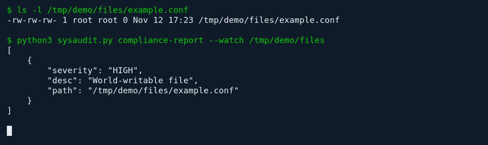

# SysAudit

Утилита GitVerse наблюдает за выбранными каталогами, фиксирует изменения в Git и формирует JSON-отчёт о правах файлов. В отчёт попадают, например, файлы с разрешением на запись для всех пользователей.



*Команды SysAudit*



*Учебный файл с правами 0666 в отчёте аудита*

## Запуск

Требуются Linux, Python 3 и Git. Проверьте отдельный каталог с тестовыми файлами.

```bash
mkdir -p demo
touch demo/example.conf
chmod 666 demo/example.conf
python3 sysaudit.py compliance-report --watch demo
```

## Что проверено

В Debian вызвана справка и выполнен аудит учебного каталога. В результате появился объект с уровнем HIGH и описанием World-writable file. Фоновый мониторинг и откат не проверялись.

## Авторство

Вячеслав Георгиевич Кузнецов. GitVerse, задание 1.
